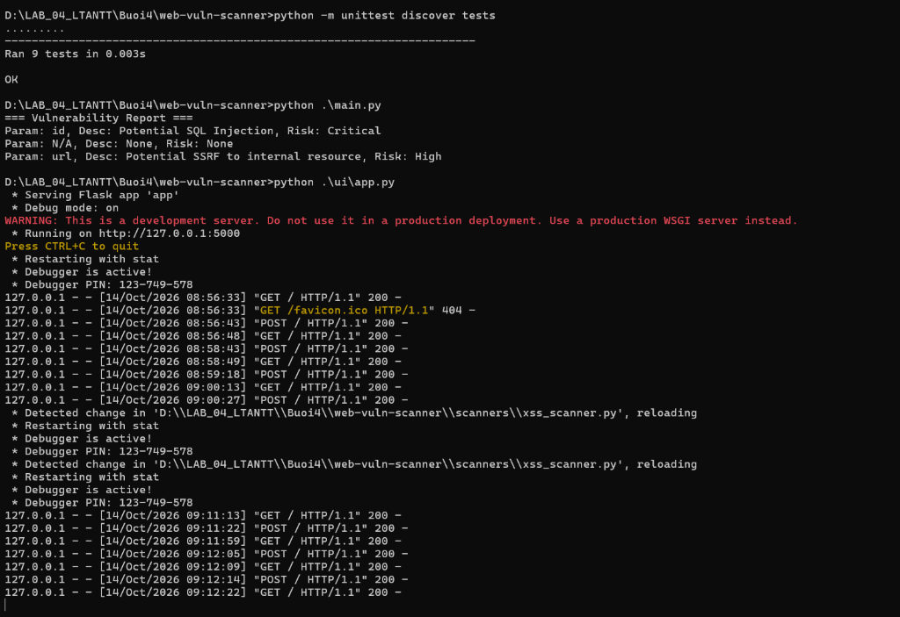
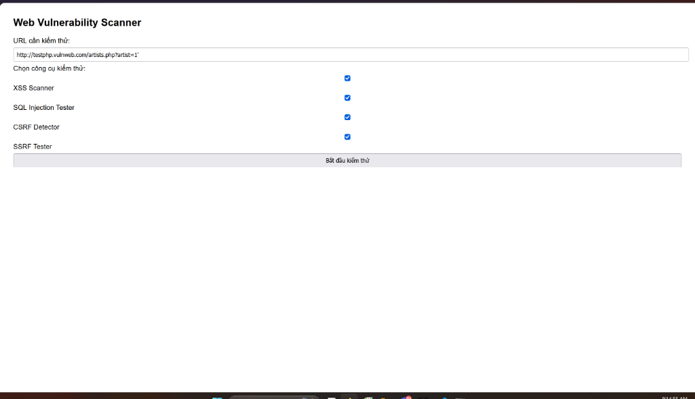
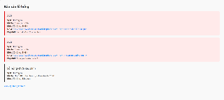

# BÁO CÁO THỰC HÀNH - BÀI 4: BẢO MẬT WEB APP VÀ API

- **Môn học:** Lập trình An ninh Thông tin
- **Sinh viên thực hiện:** Nguyễn Phi Phúc
- **Mã số sinh viên (MSSV):** 2387701131
- **Mã lớp:** LTANTT

---

## MỤC LỤC
1. [Giới thiệu tổng quan](#1-giới-thiệu-tổng-quan)
2. [Phần 1: Công cụ quét lỗ hổng Web (Web Vulnerability Scanner)](#2-phần-1-công-cụ-quét-lỗ-hổng-web-web-vulnerability-scanner)
   - [2.1. Cơ chế và nguyên lý hoạt động](#21-cơ-chế-và-nguyên-lý-hoạt-động)
   - [2.2. Minh chứng thực nghiệm 1: Kiểm thử Unit Test, CLI và Khởi động Server](#22-minh-chứng-thực-nghiệm-1-kiểm-thử-unit-test-cli-và-khởi-động-server)
   - [2.3. Minh chứng thực nghiệm 2: Giao diện Form kiểm thử Web Scanner](#23-minh-chứng-thực-nghiệm-2-giao-diện-form-kiểm-thử-web-scanner)
   - [2.4. Minh chứng thực nghiệm 3: Báo cáo kết quả quét lỗ hổng trên Web](#24-minh-chứng-thực-nghiệm-3-báo-cáo-kết-quả-quét-lỗ-hổng-trên-web)
3. [Phần 2: Bộ công cụ bảo mật JWT và OAuth 2.0 (JWTSecure)](#3-phần-2-bộ-công-cụ-bảo-mật-jwt-và-oauth-20-jwtsecure)
   - [3.1. Cấu trúc và cơ chế an toàn](#31-cấu-trúc-và-cơ-chế-an-toàn)
   - [3.2. Kiểm thử và xác thực API](#32-kiểm-thử-và-xác-thực-api)
4. [Tổng kết và Đánh giá an toàn](#4-tổng-kết-và-đánh-giá-an-toàn)

---

## 1. GIỚI THIỆU TỔNG QUAN

Trong bối cảnh các ứng dụng web và API hiện đại ngày càng trở thành mục tiêu hàng đầu của các cuộc tấn công mạng, việc nắm vững cơ chế nhận diện, khai thác và phòng chống các lỗ hổng là yêu cầu cốt lõi. Báo cáo này trình bày kết quả thực hành bài học số 4 với 2 hệ thống chính:
- **`web-vuln-scanner`**: Bộ công cụ tự động phát hiện 4 lỗ hổng nghiêm trọng gồm Cross-Site Scripting (Reflected XSS), SQL Injection (SQLi), Cross-Site Request Forgery (CSRF) và Server-Side Request Forgery (SSRF) tích hợp giao diện người dùng Flask Web UI.
- **`jwt-security-tools`**: Hệ thống xác thực an toàn bằng JSON Web Token (JWT) và OAuth 2.0, bảo vệ cổng API Gateway, kiểm định tính toàn vẹn của token, thử nghiệm tấn công dò khóa yếu (Dictionary Brute-force Attack) và quản trị vòng đời token (Access Token & Refresh Token).

---

## 2. PHẦN 1: CÔNG CỤ QUÉT LỖ HỔNG WEB (WEB VULNERABILITY SCANNER)

### 2.1. Cơ chế và nguyên lý hoạt động

Hệ thống được thiết kế theo mô hình module hóa cao:
1. **Module `CSRFDetector` (`scanners/csrf_detector.py`):**
   - Phân tích cú pháp HTML của các biểu mẫu (`<form>`) bằng biểu thức chính quy (Regex).
   - Kiểm tra sự hiện diện của các thuộc tính token bảo vệ: `csrf_token`, `_csrf`, hoặc `csrfmiddlewaretoken`.
   - Nếu biểu mẫu thiếu token, hệ thống đánh giá nguy cơ bị tấn công CSRF ở mức **Medium**.
2. **Module `SQLInjectionTester` (`scanners/sql_injection_tester.py`):**
   - Phân tích các tham số truy vấn trên URL (Query Parameters) thông qua `urllib.parse`.
   - Kiểm tra đối chiếu với từ điển payload kinh điển: `' OR '1'='1`, `'; DROP TABLE users;--`, `" OR 1=1--`, `' UNION SELECT NULL--`.
   - Nếu phát hiện dấu hiệu can thiệp truy vấn SQL, cảnh báo mức độ rủi ro tối cao **Critical**.
3. **Module `SSRFTester` (`scanners/ssrf_tester.py`):**
   - Rà soát giá trị của các tham số đầu vào xem có chứa địa chỉ loopback hoặc các dải IP Private nội bộ: `127.0.0.1`, `localhost`, `10.0.0.0/8`, `192.168.0.0/16`, `172.16.0.0/12`.
   - Ngăn chặn kẻ tấn công lợi dụng máy chủ web để tấn công leo thang vào hạ tầng mạng nội bộ hoặc dịch vụ Cloud Metadata, cảnh báo mức **High**.
4. **Module `XSSScanner` (`scanners/xss_scanner.py`):**
   - Thử nghiệm chèn các payload JavaScript/SVG: `<script>alert(1)</script>` và `"><svg/onload=alert(1)>`.
   - Phân tích phản hồi HTTP để xác định mã độc có bị phản xạ (Reflected) nguyên vẹn về trình duyệt hay không, cảnh báo mức **HIGH**.
5. **Module `ReportGenerator` (`report/report_generator.py`):**
   - Chuẩn hóa và tổng hợp toàn bộ danh sách phát hiện thành cấu trúc dữ liệu báo cáo thống nhất để hiển thị trực quan.

---

### 2.2. Minh chứng thực nghiệm 1: Kiểm thử Unit Test, CLI và Khởi động Server

Hình ảnh dưới đây ghi lại toàn bộ quá trình thực thi kiểm thử tự động, chạy chương trình dòng lệnh và khởi động máy chủ Flask Web UI:



#### 📝 Phân tích chi tiết kết quả thực thi:
1. **Kiểm thử tự động bằng Unit Test (`python -m unittest discover tests`):**
   - Hệ thống tự động phát hiện và thực thi thành công **9 test cases** trong thư mục `tests/` (`test_csrf.py`, `test_sql_injection.py`, `test_ssrf.py`, `test_xss.py`, `test_report.py`).
   - Kết quả: `Ran 9 tests in 0.003s` -> **`OK`**. Điều này khẳng định 100% các thuật toán phát hiện lỗ hổng và bộ tạo báo cáo hoạt động chính xác theo đặc tả.
2. **Thực thi kịch bản quét dòng lệnh (`python .\main.py`):**
   - Chương trình quét một URL tổng hợp mẫu và in báo cáo phân loại rõ ràng:
     - `Param: id, Desc: Potential SQL Injection, Risk: Critical` (Phát hiện tham số `id` chứa payload SQLi).
     - `Param: N/A, Desc: None, Risk: None` (CSRF form có token hợp lệ).
     - `Param: url, Desc: Potential SSRF to internal resource, Risk: High` (Phát hiện tham số `url` trỏ về IP nội bộ `127.0.0.1`).
3. **Khởi động máy chủ Flask Web UI (`python .\ui\app.py`):**
   - Máy chủ phát triển của Flask được kích hoạt tại địa chỉ cục bộ `http://127.0.0.1:5000`.
   - Chế độ Debug Mode được bật (`Debug mode: on`) cùng tính năng theo dõi thay đổi mã nguồn tự động (`Restarting with stat`).
   - Lịch sử truy cập hiển thị các lượt yêu cầu HTTP `GET` và `POST` tương tác từ trình duyệt web với mã phản hồi `200 OK`.

---

### 2.3. Minh chứng thực nghiệm 2: Giao diện Form kiểm thử Web Scanner

Giao diện Web được thiết kế tối giản, trực quan giúp người dùng dễ dàng cấu hình và kích hoạt các module kiểm thử:



#### 📝 Phân tích chi tiết giao diện và tính năng:
1. **Mục tiêu kiểm thử (URL Input):**
   - Người dùng nhập đường dẫn cần rà soát an ninh mạng: `http://testphp.vulnweb.com/artists.php?artist=1'`.
   - Đây là trang web thực hành an toàn tiêu chuẩn do hãng Acunetix cung cấp để phục vụ nghiên cứu và kiểm thử bảo mật.
2. **Bộ chọn công cụ kiểm thử (Scanner Options):**
   - Cung cấp 4 tùy chọn dạng Checkbox cho phép người kiểm thử linh hoạt kích hoạt từng tính năng hoặc quét toàn diện:
     - ☑️ **XSS Scanner:** Kiểm tra khả năng bị chèn mã kịch bản chéo.
     - ☑️ **SQL Injection Tester:** Thử nghiệm phát hiện câu truy vấn SQL độc hại.
     - ☑️ **CSRF Detector:** Phân tích form xem có token bảo vệ CSRF không.
     - ☑️ **SSRF Tester:** Kiểm tra các giá trị địa chỉ mạng có trỏ tới tài nguyên nội bộ không.
3. **Cơ chế xử lý Form Backend:**
   - Khi nhấn nút **"Bắt đầu kiểm thử"**, dữ liệu form được gửi qua phương thức HTTP `POST` đến route `/` của Flask.
   - Hàm `index()` trong `ui/app.py` trích xuất danh sách công cụ đã chọn bằng `request.form.getlist("scanner")` và gọi các lớp scanner tương ứng để thực hiện kiểm tra.

---

### 2.4. Minh chứng thực nghiệm 3: Báo cáo kết quả quét lỗ hổng trên Web

Sau khi hoàn tất quá trình rà quét, hệ thống tự động kết xuất báo cáo kết quả với định dạng cảnh báo màu sắc tương ứng với mức độ rủi ro:



#### 📝 Phân tích chi tiết các lỗ hổng được phát hiện:

| STT | Loại lỗ hổng | Mức độ rủi ro | Chi tiết phát hiện & Payload | Phân tích nguy cơ & Khuyến nghị khắc phục |
|:---:|:---|:---:|:---|:---|
| **1** | **XSS (Reflected)** | 🔴 **HIGH** | **URL:** `http://testphp.vulnweb.com/artists.php?artist=1?q=<script>alert(1)</script>`<br>**Payload:** `<script>alert(1)</script>` | **Nguy cơ:** Kẻ tấn công có thể chèn trực tiếp thẻ `<script>` vào trang web. Khi nạn nhân nhấp vào liên kết, mã độc sẽ tự động chạy trên trình duyệt nạn nhân, có thể đánh cắp cookie/session token.<br>**Khắc phục:** Mã hóa đầu ra (HTML Entity Encoding) và áp dụng chính sách Content Security Policy (CSP). |
| **2** | **XSS (Event-based)** | 🔴 **HIGH** | **URL:** `http://testphp.vulnweb.com/artists.php?artist=1?q="><svg/onload=alert(1)>`<br>**Payload:** `"><svg/onload=alert(1)>` | **Nguy cơ:** Kỹ thuật chèn payload qua thẻ SVG và sự kiện `onload` để vượt qua các bộ lọc lọc từ khóa `<script>` thông thường.<br>**Khắc phục:** Sử dụng thư viện lọc HTML an toàn (như DOMPurify, bleach) và không trực tiếp gán HTML thô vào trang. |
| **3** | **Lỗ hổng chưa xác định (CSRF)** | 🟡 **Medium** | **Mô tả:** `No CSRF token found, vulnerable to CSRF`<br>**Vị trí:** Không rõ (Client Form) | **Nguy cơ:** Biểu mẫu không có CSRF Token chống giả mạo, cho phép kẻ tấn công tạo trang độc hại để tự động submit form dưới quyền phiên làm việc của người dùng.<br>**Khắc phục:** Bổ sung trường ẩn `csrf_token` độc nhất cho mỗi phiên và cấu hình cookie phiên với cờ `SameSite=Strict/Lax`. |

---

## 3. PHẦN 2: BỘ CÔNG CỤ BẢO MẬT JWT VÀ OAUTH 2.0 (JWTSECURE)

### 3.1. Cấu trúc và cơ chế an toàn

Dự án [jwt-security-tools](file:///d:/LAB_04_LTANTT/Buoi4/jwt-security-tools) triển khai các cơ chế bảo mật xác thực hiện đại:
1. **API Gateway (`api_gateway/gateway.py`):**
   - Đóng vai trò là lớp bảo vệ cho endpoint `/protected`.
   - Trích xuất token từ Header `Authorization: Bearer <token>`, giải mã với thuật toán đối xứng HMAC SHA-256 (`HS256`).
   - Nếu chữ ký hợp lệ và chưa hết hạn, trả về `HTTP 200` và định danh người dùng. Ngược lại trả về `HTTP 401 Unauthorized`.
2. **JWT Cracker (`jwt_cracker/cracker.py`):**
   - Mô phỏng tấn công Brute-force từ điển (Dictionary Attack) để chứng minh sự nguy hiểm khi đặt Secret Key yếu.
   - Ứng dụng mô hình xử lý đa luồng `ThreadPoolExecutor` để tăng tốc độ thử nghiệm các khóa bí mật.
3. **JWT Validator (`jwt_validator/validator.py`):**
   - Kiểm tra toàn diện các ngoại lệ bảo mật của JWT: `ExpiredSignatureError` (token hết hạn), `InvalidSignatureError` (sai chữ ký hoặc bị làm giả dữ liệu), `InvalidTokenError` (token lỗi định dạng).
4. **OAuth 2.0 Client (`oauth_client/client.py`):**
   - Hỗ trợ luồng chuẩn **Authorization Code Flow**, sinh URL đăng nhập ủy quyền và gửi yêu cầu đổi mã cấp quyền lấy Access Token.
5. **Token Manager (`token_manager/manager.py`):**
   - Quản lý vòng đời cặp khóa: **Access Token** (thời hạn ngắn: 15 phút) dùng truy cập tài nguyên thường nhật và **Refresh Token** (thời hạn dài: 24 giờ) dùng cấp mới Access Token mà không cần người dùng nhập lại mật khẩu.

---

### 3.2. Kiểm thử và xác thực API

- **Chạy kiểm thử Pytest:**
  ```powershell
  cd Buoi4/jwt-security-tools
  $env:PYTEST_DISABLE_PLUGIN_AUTOLOAD = "1"; pytest tests/
  ```
  *Kết quả:* Thông qua toàn bộ **7/7 test cases** (`7 passed`).
- **Thực thi phát hành Token và gọi API với `curl`:**
  ```powershell
  # Terminal 1: Chạy main.py
  python .\main.py
  
  # Terminal 2: Gửi request xác thực
  curl -H "Authorization: Bearer <access_token>" http://127.0.0.1:5000/protected
  ```
  *Kết quả phản hồi:* `{"message": "Access granted", "user": "phuoc"}`.

---

## 4. TỔNG KẾT VÀ ĐÁNH GIÁ AN TOÀN

Qua quá trình thực hành Bài 4, sinh viên đã hoàn thành:
1. Xây dựng thành công công cụ phát hiện lỗ hổng ứng dụng web tự động (`web-vuln-scanner`), nắm vững bản chất kỹ thuật của các cuộc tấn công XSS, SQLi, CSRF và SSRF.
2. Triển khai hoàn chỉnh giao diện Web UI hiển thị trực quan mức độ rủi ro của từng lỗ hổng phát hiện được.
3. Xây dựng thành công giải pháp xác thực API bảo mật cao bằng JWT và OAuth 2.0, hiểu rõ cơ chế vòng đời token và cách phòng chống tấn công dò khóa HMAC yếu.
4. Tuân thủ nghiêm ngặt các quy tắc an toàn mã nguồn, ngăn chặn rò rỉ khóa bí mật (Secrets Hardcoding) trên hệ thống kiểm soát phiên bản Git.
