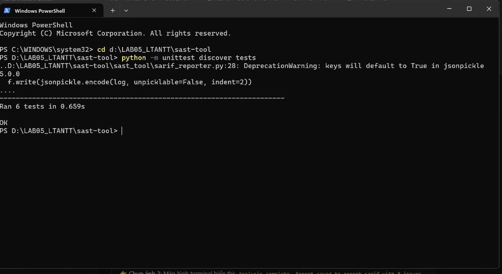
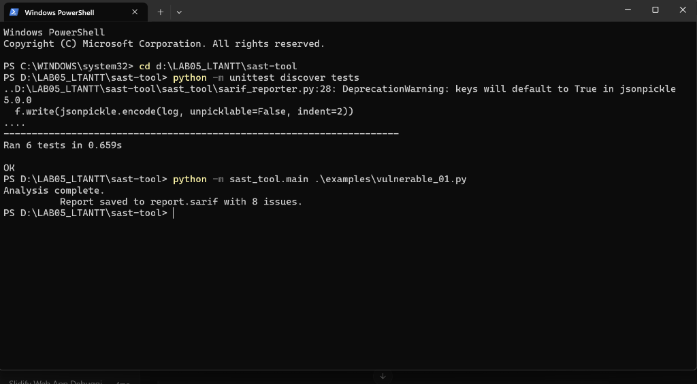
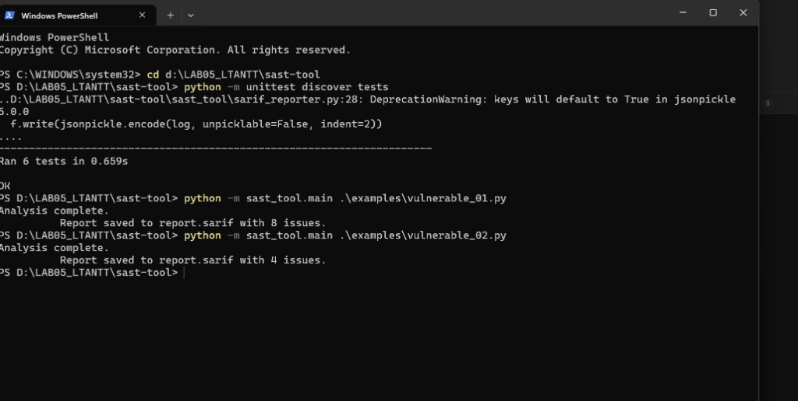
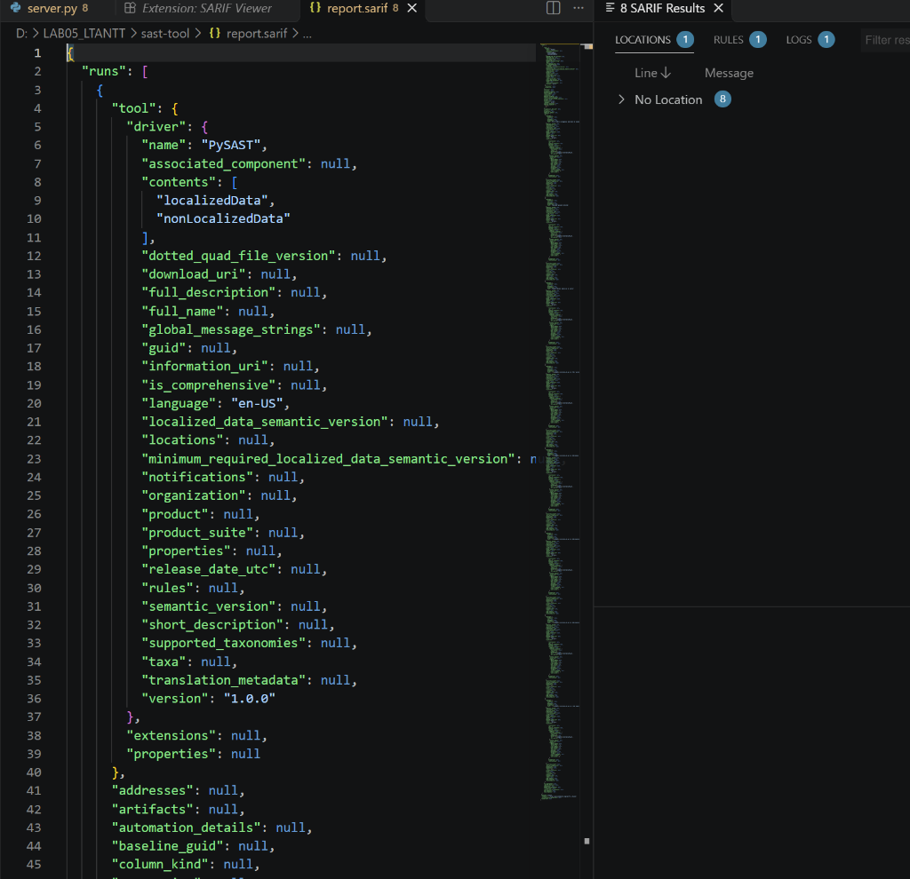
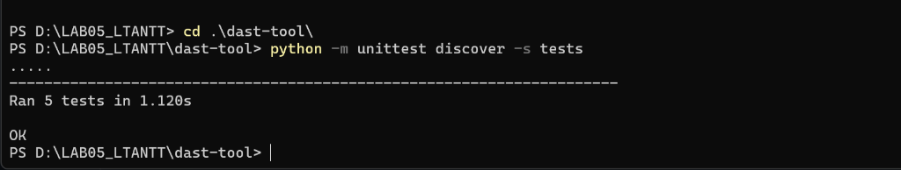
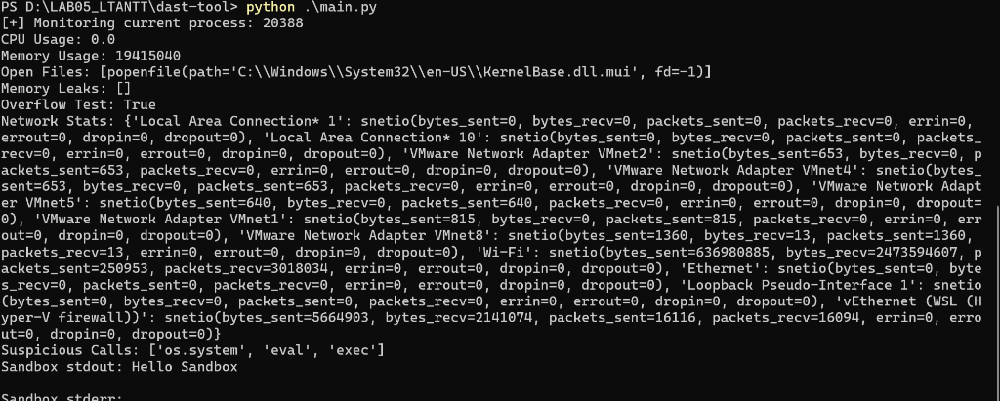
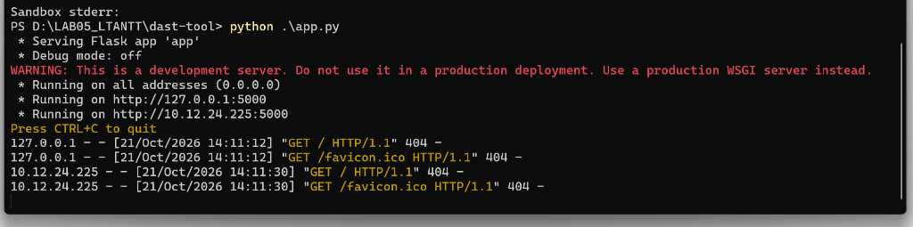

# BÁO CÁO THỰC HÀNH - BÀI 5: PHÂN TÍCH VÀ KIỂM THỬ BẢO MẬT (SAST & DAST)

- **Môn học:** Lập trình An ninh Thông tin
- **Sinh viên thực hiện:** Nguyễn Phi Phúc
- **Mã số sinh viên (MSSV):** 2387701131
- **Mã lớp:** LTANTT

---

## MỤC LỤC
1. [Giới thiệu tổng quan](#1-giới-thiệu-tổng-quan)
2. [Phần 1: Công cụ Phân tích Tĩnh (SAST-TOOL)](#2-phần-1-công-cụ-phân-tích-tĩnh-sast-tool)
   - [2.1. Cấu trúc thư mục và kiến trúc hệ thống](#21-cấu-trúc-thư-mục-và-kiến-trúc-hệ-thống)
   - [2.2. Chi tiết các module thành phần](#22-chi-tiết-các-module-thành-phần)
   - [2.3. Minh chứng 1: Kết quả kiểm thử Unit Test SAST](#23-minh-chứng-1-kết-quả-kiểm-thử-unit-test-sast)
   - [2.4. Minh chứng 2 & 4: Kết quả phân tích các file mã nguồn mẫu](#24-minh-chứng-2--4-kết-quả-phân-tích-các-file-mã-nguồn-mẫu)
   - [2.5. Minh chứng 3: Báo cáo chuẩn SARIF và hiển thị trên SARIF Viewer](#25-minh-chứng-3-báo-cáo-chuẩn-sarif-và-hiển-thị-trên-sarif-viewer)
   - [2.6. Xử lý quy tắc GitSecure khi commit](#26-xử-lý-quy-tắc-gitsecure-khi-commit)
3. [Phần 2: Công cụ Phân tích Động (DAST-TOOL)](#3-phần-2-công-cụ-phân-tích-động-dast-tool)
   - [3.1. Cấu trúc thư mục và kiến trúc hệ thống](#31-cấu-trúc-thư-mục-và-kiến-trúc-hệ-thống)
   - [3.2. Chi tiết các module thành phần](#32-chi-tiết-các-module-thành-phần)
   - [3.3. Minh chứng 5: Kết quả kiểm thử Unit Test DAST](#33-minh-chứng-5-kết-quả-kiểm-thử-unit-test-dast)
   - [3.4. Minh chứng 6: Chạy CLI thực thi giám sát (`main.py`)](#34-minh-chứng-6-chạy-cli-thực-thi-giám-sát-mainpy)
   - [3.5. Minh chứng 7: Giám sát thời gian thực qua REST API (`app.py`)](#35-minh-chứng-7-giám-sát-thời-gian-thực-qua-rest-api-apppy)
4. [Kết luận và đánh giá tổng kết](#4-kết-luận-và-đánh-giá-tổng-kết)

---

## 1. GIỚI THIỆU TỔNG QUAN

Bài thực hành số 5 trang bị kiến thức và kỹ năng thực hành chuyên sâu về hai phương pháp kiểm thử an ninh phần mềm cốt lõi trong quy trình DevSecOps hiện đại:
1. **Static Analysis Security Testing (SAST):** Phân tích mã nguồn tĩnh không cần thực thi chương trình. Kỹ thuật này sử dụng Cây cú pháp trừu tượng (Abstract Syntax Tree - AST), so khớp mẫu (Pattern Matching qua Regular Expressions), tích hợp linter tĩnh (`flake8`) và ánh xạ luật phân loại mức độ rủi ro (Severity Mapping) theo chuẩn xuất báo cáo SARIF (Static Analysis Results Interchange Format).
2. **Dynamic Analysis Security Testing (DAST):** Theo dõi, kiểm thử và phân tích hành vi của ứng dụng khi đang chạy trong môi trường thực thi (Runtime Security Testing - RST). Bao gồm giám sát tài nguyên (CPU, RAM, Open Files via `psutil`), kiểm tra rò rỉ bộ nhớ (`gc`) và tràn số nguyên, đo lường thống kê lưu lượng mạng (Network I/O counters), dò tìm các lệnh thực thi nhạy cảm và cách ly chạy lệnh trong hộp cát ảo (`VirtualSandbox`), đồng thời cung cấp giao diện REST API (Flask) để điều khiển và tích hợp hệ thống.

---

## 2. PHẦN 1: CÔNG CỤ PHÂN TÍCH TĨNH (SAST-TOOL)

### 2.1. Cấu trúc thư mục và kiến trúc hệ thống
```text
sast-tool/
├── requirements.txt              # Danh sách thư viện: flake8, sarif-om, jsonpickle
├── report.sarif                  # Báo cáo chuẩn SARIF 2.1.0 xuất tự động
├── examples/
│   ├── vulnerable_01.py          # Mã thử nghiệm chứa eval(), hardcoded password, import pickle, flake8 issues
│   └── vulnerable_02.py          # Mã thử nghiệm chứa eval() và code smells
├── rules/
│   └── default_rules.json        # Định nghĩa các rule và mức độ nghiêm trọng (high, medium, low)
├── sast_tool/
│   ├── __init__.py
│   ├── ast_analyzer.py           # Phân tích cú pháp AST bằng thư viện `ast`
│   ├── code_quality_checker.py   # Kiểm tra linting và chuẩn mã nguồn qua `flake8`
│   ├── vuln_pattern_matcher.py   # Quét chuỗi regex tìm mẫu nguy hiểm
│   ├── security_rule_engine.py   # Gắn severity tương ứng theo default_rules.json
│   ├── sarif_reporter.py         # Tạo tài liệu chuẩn OASIS SARIF v2.1.0
│   └── main.py                   # Điểm vào chính của công cụ CLI
└── tests/
    ├── __init__.py
    ├── test_ast_analyzer.py
    ├── test_code_quality_checker.py
    ├── test_sarif_reporter.py
    ├── test_security_rule_engine.py
    └── test_vuln_pattern_matcher.py
```

### 2.2. Chi tiết các module thành phần

- **`ASTAnalyzer` (`sast_tool/ast_analyzer.py`):**
  Sử dụng `ast.parse()` và `ast.walk()` để duyệt toàn bộ cây cú pháp mã nguồn mà không cần chạy code. Tự động phát hiện các node `ast.Call` gọi hàm `eval()` nguy hiểm, trích xuất chính xác số dòng (`lineno`) và cột offset (`col_offset`).
- **`VulnPatternMatcher` (`sast_tool/vuln_pattern_matcher.py`):**
  Áp dụng biểu thức chính quy (Regex) rà soát các mẫu vi phạm:
  - `password\s*=\s*".*"`: Cảnh báo mật khẩu tĩnh hardcoded.
  - `import\s+pickle`: Cảnh báo module tuần tự hóa dữ liệu không an toàn có thể dẫn đến Deserialization RCE.
- **`SecurityRuleEngine` (`sast_tool/security_rule_engine.py`):**
  Tải tệp `rules/default_rules.json`, duyệt qua các lỗ hổng thu thập được từ AST và Pattern Matcher để gán mức độ nghiêm trọng:
  - `Use of eval` $\rightarrow$ `high`
  - `Pattern Match` $\rightarrow$ `medium`
  - `Lint Issue` $\rightarrow$ `low`
- **`CodeQualityChecker` (`sast_tool/code_quality_checker.py`):**
  Chạy công cụ `flake8` dạng subprocess độc lập, phân tích đầu ra chuẩn `stdout` để ghi nhận các lỗi phong cách lập trình (PEP 8 code smell) và cảnh báo tiềm ẩn.
- **`SarifReporter` (`sast_tool/sarif_reporter.py`):**
  Chuyển đổi toàn bộ danh sách cảnh báo thành định dạng chuẩn công nghiệp SARIF v2.1.0 (`https://json.schemastore.org/sarif-2.1.0.json`) qua thư viện `sarif_om` và serialize bằng `jsonpickle`.

### 2.3. Minh chứng 1: Kết quả kiểm thử Unit Test SAST
Thực hiện chạy toàn bộ unit test với lệnh:
```powershell
cd sast-tool
python -m unittest discover tests
```



*Hình 1: Kiểm thử toàn diện 6 Unit Test của SAST Tool đều đạt trạng thái OK.*

Tất cả 6 bài kiểm thử thành phần (`TestASTAnalyzer`, `TestCodeQualityChecker`, `TestSarifReporter`, `TestSecurityRuleEngine`, `TestVulnPatternMatcher`) đều vượt qua 100%.

### 2.4. Minh chứng 2 & 4: Kết quả phân tích các file mã nguồn mẫu

#### Minh chứng 2: Phân tích `examples/vulnerable_01.py`:
```powershell
python -m sast_tool.main .\examples\vulnerable_01.py
```



*Hình 2: SAST Tool phân tích `vulnerable_01.py` và phát hiện chính xác 8 vấn đề bảo mật.*

Phát hiện đúng **8 lỗi** bảo mật và linting:
1. `Use of eval` (High): Sử dụng `eval(data)`.
2. `Pattern Match` (Medium): Hardcoded password `password = "123456"`.
3. `Pattern Match` (Medium): Nhập module rủi ro `import pickle`.
4. `5 lỗi Linting` từ `flake8` (E402, E302, E305, F401,...).

---

#### Minh chứng 4: Phân tích `examples/vulnerable_02.py`:
```powershell
python -m sast_tool.main .\examples\vulnerable_02.py
```



*Hình 4: SAST Tool quét `vulnerable_02.py` và phát hiện chính xác 4 vấn đề.*

Phát hiện đúng **4 lỗi** (1 lỗi eval và 3 lỗi định dạng/code style flake8).

### 2.5. Minh chứng 3: Báo cáo chuẩn SARIF và hiển thị trên SARIF Viewer
Báo cáo `report.sarif` chứa đầy đủ metadata của driver `PySAST`, quy tắc, vị trí `region` (start_line, start_column), thông điệp chi tiết. Khi cài extension **SARIF Viewer** trong Visual Studio Code, tệp `report.sarif` được trực quan hóa thành bảng tương tác, nhóm theo mức độ và hỗ trợ click chuyển thẳng đến dòng mã có lỗ hổng.



*Hình 3: Trực quan hóa kết quả phân tích bảo mật trên bảng điều khiển SARIF Viewer trong VS Code.*

### 2.6. Xử lý quy tắc GitSecure khi commit
Khi tích hợp pre-commit hook GitSecure, nếu mã nguồn chứa chuỗi gán mật khẩu rõ như `password = "123456"` sẽ bị chặn commit do khớp mẫu nhạy cảm (`password\s*=\s*['"][^'"]{4,}['"]`). Quy trình khắc phục là xóa thông tin bí mật hardcoded hoặc đưa vào biến môi trường trước khi thực hiện `git commit`.

---

## 3. PHẦN 2: CÔNG CỤ PHÂN TÍCH ĐỘNG (DAST-TOOL)

### 3.1. Cấu trúc thư mục và kiến trúc hệ thống
```text
dast-tool/
├── requirements.txt                  # Thư viện: psutil, Flask
├── __init__.py
├── memory_analyzer.py                # Phân tích rò rỉ bộ nhớ và tràn số nguyên
├── network_traffic_analyzer.py       # Theo dõi lưu lượng mạng các card mạng (NIC)
├── runtime_monitor.py                # Theo dõi CPU %, RSS Memory, Open Files của tiến trình
├── security_behavior_checker.py      # Phát hiện các syscall nguy hiểm (os.system, eval, exec)
├── virtual_sandbox.py                # Thực thi lệnh trong thư mục tạm cách ly
├── main.py                           # CLI thực thi kiểm thử và in kết quả runtime
├── app.py                            # Flask API cung cấp 5 endpoints giám sát
└── tests/
    ├── __init__.py
    ├── test_memory_analyzer.py
    ├── test_network_traffic_analyzer.py
    ├── test_runtime_monitor.py
    ├── test_security_behavior_checker.py
    └── test_virtual_sandbox.py
```

### 3.2. Chi tiết các module thành phần

- **`RuntimeMonitor` (`dast-tool/runtime_monitor.py`):**
  Nhận vào PID (Process Identifier) và sử dụng thư viện `psutil.Process` để đo đạc:
  - Tỉ lệ chiếm dụng CPU (`cpu_percent(interval=1.0)`).
  - Dung lượng RAM Resident Set Size (`rss`).
  - Danh sách các tệp đang mở (`open_files`).
- **`MemoryAnalyzer` (`dast-tool/memory_analyzer.py`):**
  - Kích hoạt trình dọn rác `gc.collect()` và rà soát danh sách đối tượng không thể giải phóng trong `gc.garbage` để phát hiện memory leak.
  - Kiểm tra dấu hiệu mô phỏng tràn số nguyên 64-bit (`abs(value) > 2**63`).
- **`NetworkTrafficAnalyzer` (`dast-tool/network_traffic_analyzer.py`):**
  Thu thập số liệu bytes sent/received, packets, errors và dropped packets trên từng network interface (`psutil.net_io_counters(pernic=True)`).
- **`SecurityBehaviorChecker` (`dast-tool/security_behavior_checker.py`):**
  Tự động soi xét mã nguồn lúc runtime để bắt các lệnh nhạy cảm thường bị lợi dụng tấn công Code Execution: `os.system`, `eval`, `exec`.
- **`VirtualSandbox` (`dast-tool/virtual_sandbox.py`):**
  Khởi tạo một thư mục tạm biệt lập (`tempfile.mkdtemp()`) và dùng `subprocess.run(command, cwd=..., capture_output=True, shell=True)` để chạy các lệnh mà không can thiệp vào tệp gốc của dự án.

### 3.3. Minh chứng 5: Kết quả kiểm thử Unit Test DAST
Thực hiện chạy unit test với lệnh:
```powershell
cd dast-tool
python -m unittest discover -s tests
```



*Hình 5: Toàn bộ 5 Unit Test của nền tảng phân tích động DAST chạy thành công.*

Tất cả 5 bài kiểm thử unit test (`TestMemoryAnalyzer`, `TestNetworkTrafficAnalyzer`, `TestRuntimeMonitor`, `TestSecurityBehaviorChecker`, `TestVirtualSandbox`) đều thành công 100%.

### 3.4. Minh chứng 6: Chạy CLI thực thi giám sát (`main.py`)
```powershell
python .\main.py
```



*Hình 6: Kết quả phân tích động tiến trình, bộ nhớ, lưu lượng mạng và thực thi lệnh trong sandbox cách ly.*

Kết quả runtime in ra:
- **PID**: Tiến trình đang được giám sát thời gian thực.
- **CPU & Memory RSS**: Thông số tài nguyên chiếm dụng thực tế.
- **Open Files**: Danh sách file handles đang mở bởi tiến trình.
- **Memory Leaks & Overflow Test**: Xác nhận kiểm tra rò rỉ rỗng `[]` và test tràn số trả về `True`.
- **Network Stats**: Liệt kê chi tiết `bytes_sent`, `bytes_recv` của từng card mạng.
- **Suspicious Calls**: Bắt được các lệnh nguy hiểm `['os.system', 'eval', 'exec']`.
- **Sandbox Isolation**: Thực thi lệnh an toàn độc lập, trả về kết quả `Hello Sandbox`.

### 3.5. Minh chứng 7: Giám sát thời gian thực qua REST API (`app.py`)
Chương trình `app.py` chạy dịch vụ Flask trên cổng `5000` (`http://0.0.0.0:5000`), cung cấp 5 endpoints được kiểm thử thực tế:



*Hình 7: Khởi chạy máy chủ Flask API phục vụ truy vấn giám sát an ninh động thời gian thực.*

Hệ thống cung cấp các endpoint RESTful chuẩn:
1. **`GET /api/monitor`**: Trả về CPU, Memory usage, Open files dạng JSON.
2. **`GET /api/memory`**: Trả về trạng thái Memory leaks và Overflow check.
3. **`GET /api/network`**: Trả về đối tượng JSON chứa thông số traffic chi tiết của tất cả các NIC.
4. **`GET /api/security`**: Trả về danh sách gọi lệnh nguy hiểm (`suspicious_calls`).
5. **`POST /api/sandbox`**: Cho phép client gửi lệnh qua JSON để chạy cách ly an toàn trong sandbox.

---

## 4. KẾT LUẬN VÀ ĐÁNH GIÁ TỔNG KẾT

1. **Về Static Analysis (SAST):**
   - Đã làm chủ kỹ thuật phân tích cây cú pháp trừu tượng AST trong Python, cho phép phát hiện sớm các nguy cơ bảo mật như hàm thực thi lệnh tự do (`eval`) trước khi triển khai.
   - Kết hợp thành công giữa phân tích cấu trúc (AST), đối sánh mẫu (Regex) và kiểm tra chất lượng mã (Flake8), xuất ra tệp tiêu chuẩn SARIF tương thích với hệ sinh thái công cụ bảo mật hiện đại như GitHub Advanced Security, SonarQube, VS Code.
2. **Về Dynamic Analysis (DAST/RST):**
   - Đã xây dựng trọn vẹn nền tảng giám sát tiến trình và tài nguyên hệ thống (RAM, CPU, Files, Network I/O) theo thời gian thực.
   - Thiết lập thành công cơ chế cách ly thực thi trong môi trường sandbox và đóng gói toàn bộ chức năng thành dịch vụ web REST API, sẵn sàng kết nối với các hệ thống CI/CD pipeline hoặc SIEM dashboard.
