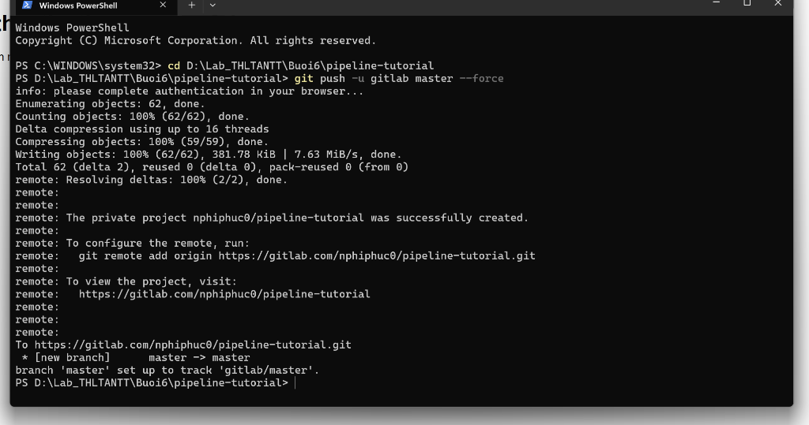
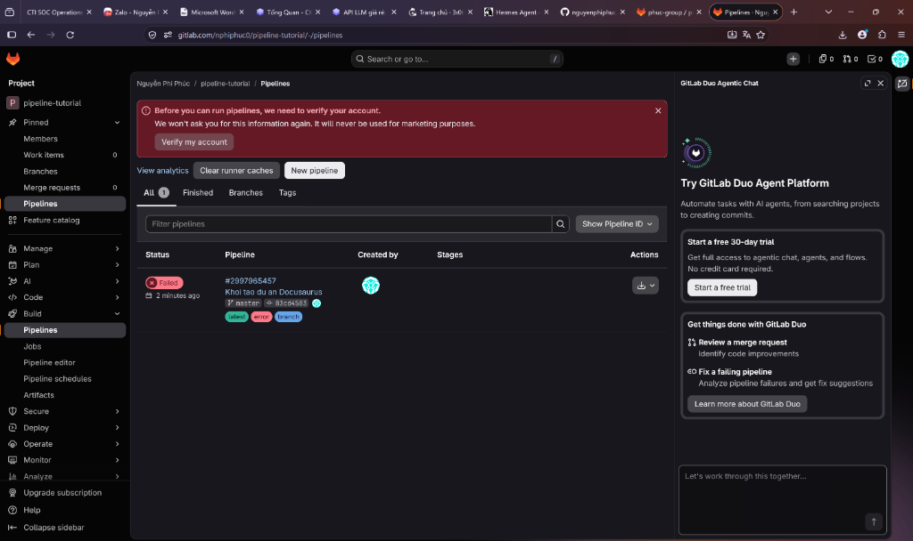
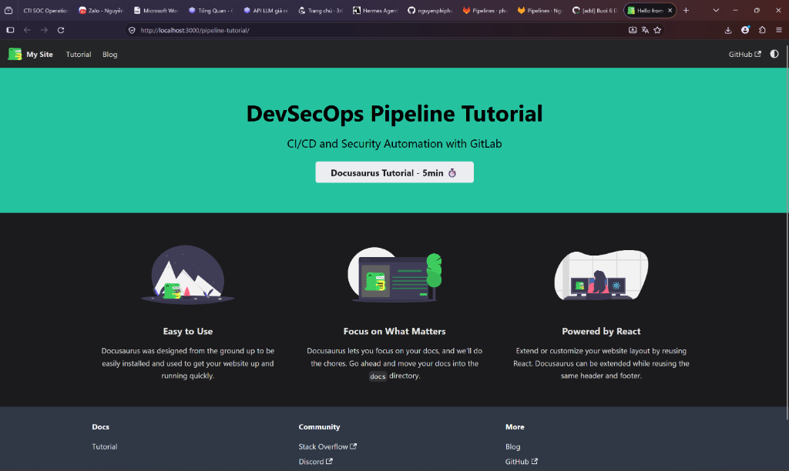
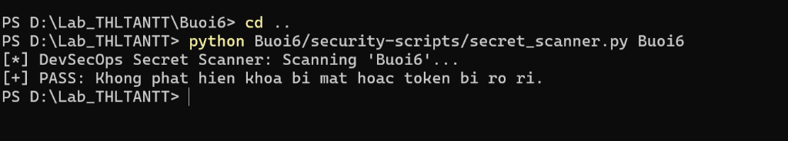
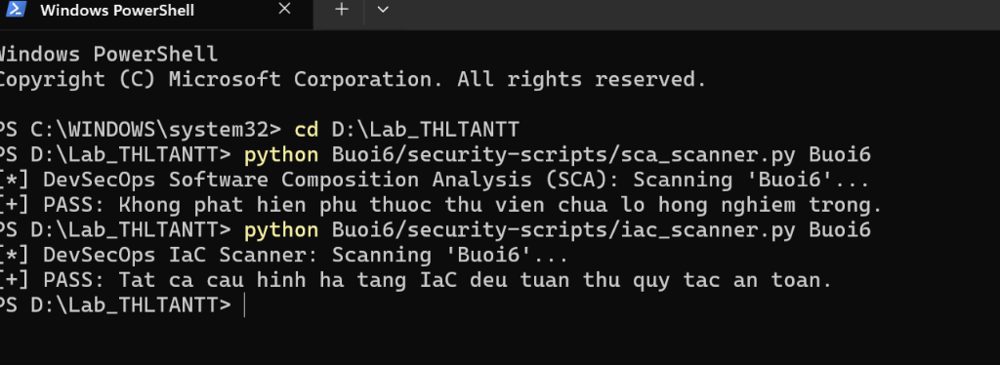
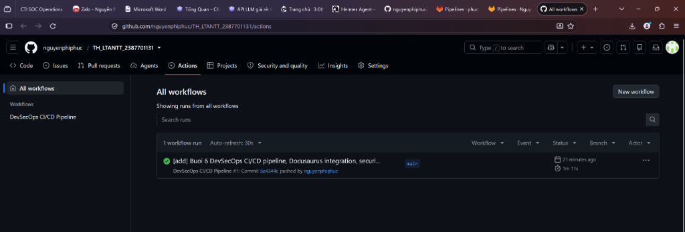
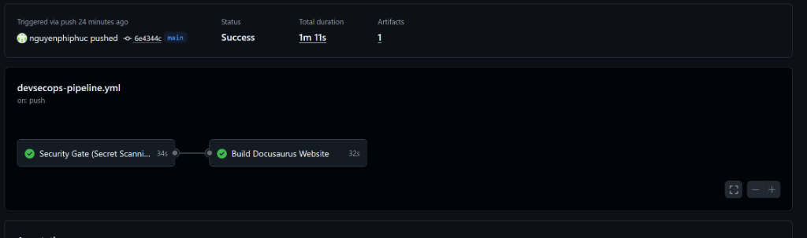

# BÁO CÁO THỰC HÀNH - BÀI 6: BẢO MẬT VỚI DEVSECOPS

- **Môn học:** Lập trình An ninh Thông tin
- **Sinh viên thực hiện:** Nguyễn Phi Phúc
- **Mã số sinh viên (MSSV):** 2387701131
- **Mã lớp:** LTANTT

---

## MỤC LỤC
1. [Giới thiệu tổng quan DevSecOps](#1-giới-thiệu-tổng-quan-devsecops)
2. [Cấu trúc thư mục buổi thực hành](#2-cấu-trúc-thư-mục-buổi-thực-hành)
3. [Thiết kế Pipeline CI/CD và kiểm thử bảo mật](#3-thiết-kế-pipeline-cicd-và-kiểm-thử-bảo-mật)
4. [Thực hành 1: Xây dựng Pipeline GitLab CI/CD cơ bản](#4-thực-hành-1-xây-dựng-pipeline-gitlab-cicd-cơ-bản)
5. [Thực hành 2: Pipeline GitLab CI/CD triển khai dự án Docusaurus](#5-thực-hành-2-pipeline-gitlab-cicd-triển-khai-dự-án-docusaurus)
6. [Tích hợp chốt chặn an ninh DevSecOps](#6-tích-hợp-chốt-chặn-an-ninh-devsecops)
7. [Tự động hóa kiểm thử trên GitHub Actions](#7-tự-động-hóa-kiểm-thử-trên-github-actions)
8. [Kết luận và đánh giá thực nghiệm](#8-kết-luận-và-đánh-giá-thực-nghiệm)

---

## 1. GIỚI THIỆU TỔNG QUAN DEVSECOPS

Quy trình phát triển phần mềm hiện đại đòi hỏi tốc độ phát hành nhanh đi kèm độ an toàn hệ thống. Phương pháp kết hợp kiểm thử an ninh xuyên suốt chu trình phát triển phần mềm được gọi là DevSecOps.

Mục tiêu chính của DevSecOps là dịch chuyển việc kiểm thử an ninh sang giai đoạn sớm của dự án, thường gọi là Shift Left Security. Thay vì phát hiện lỗi ở bước vận hành cuối cùng, các công cụ kiểm tra tự động được tích hợp trực tiếp vào quy trình tích hợp liên tục và triển khai liên tục (CI/CD). Phương pháp này giúp phát hiện sai sót lập trình, rò rỉ khóa bí mật và mã độc trước khi ứng dụng được đưa lên môi trường thực tế.

---

## 2. CẤU TRÚC THƯ MỤC BUỔI THỰC HÀNH

Cấu trúc các thư mục và tệp tin mã nguồn trong thư mục `Buoi6`:

```text
Buoi6/
├── images/
│   ├── 1_secret_scanner.png                # Ket qua quet ro ri khoa bi mat
│   ├── 2_gitlab_push_docusaurus.png        # Day ma nguon Docusaurus len GitLab
│   ├── 3_gitlab_pipeline_verify.png        # Giao dien pipeline va xac thuc GitLab
│   ├── 4_github_actions_success.png        # Tong quan pipeline tren GitHub Actions
│   ├── 5_github_actions_pipeline_detail.png# Chi tiet cac cong viec Security Gate va Build
│   ├── 6_docusaurus_portal.png             # Giao dien cong thong tin Docusaurus
│   └── 7_sca_iac_scanners.png              # Ket qua quet an ninh SCA va ha tang IaC
├── gitlab-ci-basic/
│   └── .gitlab-ci.yml                      # Pipeline co ban gom 4 job va 3 stage
├── pipeline-tutorial/
│   ├── .gitlab-ci-step1-initial.yml        # Buoc 1: Pipeline khoi dau voi test-job
│   ├── .gitlab-ci-step2-build.yml          # Buoc 2: Pipeline bien dich Node.js
│   ├── .gitlab-ci.yml                      # Buoc 3: Pipeline hoan chinh GitLab Pages
│   ├── .gitlab-ci-devsecops.yml            # Pipeline tich hop cac chot an ninh
│   ├── docusaurus.config.js                # Cau hinh baseUrl va url he thong
│   ├── package.json                        # Khai bao goi phu thuoc Node.js
│   ├── docs/                               # Tai lieu Markdown du an
│   ├── src/                                # Ma nguon giao dien React
│   └── static/                             # Tai nguyen tinh gom hinh anh va bieu tuong
├── security-scripts/
│   ├── secret_scanner.py                   # Cong cu quet khoa bi mat trong ma nguon
│   ├── sca_scanner.py                      # Cong cu quet lo hong phu thuoc thu vien
│   └── iac_scanner.py                      # Cong cu quet loi cau hinh ha tang IaC
└── README.md                               # Bao cao chi tiet buoi thuc hanh
```

---

## 3. THIẾT KẾ PIPELINE CI/CD VÀ KIỂM THỬ BẢO MẬT

### 3.1. Các thành phần trong thiết kế pipeline an toàn

- **Kiểm soát quyền truy cập:** Thiết lập cơ chế phân quyền theo nguyên tắc đặc quyền tối thiểu. Yêu cầu bật xác thực đa yếu tố (MFA) đối với các tài khoản có quyền chỉnh sửa cấu hình pipeline.
- **Quản lý thông tin bí mật:** Nghiêm cấm ghi trực tiếp mật khẩu, token hoặc khóa bí mật vào kho mã nguồn. Các khóa truy cập được lưu trữ trong kho quản lý chuyên dụng hoặc biến môi trường bảo mật của hệ thống CI/CD.
- **Ký và kiểm tra mã nguồn:** Sử dụng chữ ký số để xác thực tính toàn vẹn của mã nguồn commit và gói cài đặt phần mềm sau khi biên dịch.
- **Tự động hóa chốt kiểm tra an ninh:** Đặt các cổng chặn bắt buộc trước khi cho phép chuyển giao phần mềm sang giai đoạn kế tiếp.
- **Giám sát nhật ký thực thi:** Ghi nhận toàn bộ sự kiện chạy pipeline để phục vụ công tác kiểm tra sau sự cố.
- **Bảo vệ môi trường thực thi Runner:** Cách ly trình chạy trong môi trường container để ngăn chặn mã độc can thiệp vào máy chủ điều khiển.

### 3.2. Bốn kỹ thuật kiểm thử an ninh tự động

- **Phân tích tĩnh (SAST):** Phân tích mã nguồn khi chưa thực thi để phát hiện lỗi logic, cấu trúc câu lệnh không an toàn hoặc dấu hiệu tiêm mã độc.
- **Phân tích động (DAST):** Kiểm thử ứng dụng tại thời điểm đang chạy trong môi trường kiểm thử để phát hiện hành vi nguy hiểm.
- **Phân tích thành phần bên thứ ba (SCA):** Rà soát các thư viện ngoài được khai báo trong dự án nhằm xác định các gói chứa lỗ hổng bảo mật đã công bố.
- **Dò tìm khóa bí mật qua Secret Scanning:** Quét toàn bộ lịch sử commit và nội dung tệp tin để phát hiện token, mật khẩu hoặc chứng chỉ bị lộ.

### 3.3. Bảo mật hạ tầng dưới dạng mã IaC

Hạ tầng dưới dạng mã (IaC) cho phép triển khai hệ thống thông qua các tệp tin cấu hình. Bảo mật IaC tập trung vào các nhiệm vụ:
- Kiểm tra cấu hình để ngăn ngừa quyền truy cập vượt quá mức cần thiết.
- Ngăn chặn việc sử dụng tài khoản quản trị tối cao root trong container.
- Loại bỏ các cổng mạng không an toàn hoặc các liên kết tệp nhạy cảm của hệ điều hành máy chủ.

---

## 4. THỰC HÀNH 1: XÂY DỰNG PIPELINE GITLAB CI/CD CƠ BẢN

### 4.1. Cấu hình tệp `.gitlab-ci.yml` cơ bản

Tệp cấu hình tại đường dẫn `Buoi6/gitlab-ci-basic/.gitlab-ci.yml` định nghĩa 4 công việc trên 3 giai đoạn:

```yaml
build-job:
  stage: build
  script:
    - echo "Hello, $GITLAB_USER_LOGIN!"

test-job1:
  stage: test
  script:
    - echo "This job tests something"

test-job2:
  stage: test
  script:
    - echo "This job tests something, but takes more time than test-job1."
    - echo "After the echo commands complete, it runs the sleep command for 20 seconds"
    - echo "which simulates a test that runs 20 seconds longer than test-job1"
    - sleep 20

deploy-prod:
  stage: deploy
  script:
    - echo "This job deploys something from the $CI_COMMIT_BRANCH branch."
  environment: production
```

### 4.2. Phân tích cơ chế thực thi

- `stage: build`: Công việc `build-job` chạy đầu tiên, xuất lời chào kèm tên tài khoản thực hiện qua biến `$GITLAB_USER_LOGIN`.
- `stage: test`: Hai công việc `test-job1` và `test-job2` được thực thi đồng thời. Công việc `test-job2` mô phỏng kiểm thử kéo dài qua lệnh `sleep 20`.
- `stage: deploy`: Sau khi toàn bộ các công việc ở stage test hoàn tất thành công, công việc `deploy-prod` được khởi chạy để đưa ứng dụng lên môi trường sản xuất `production`. Biến `$CI_COMMIT_BRANCH` trả về tên nhánh mã nguồn hiện tại.

---

## 5. THỰC HÀNH 2: PIPELINE GITLAB CI/CD TRIỂN KHAI DỰ ÁN DOCUSAURUS

### 5.1. Khởi tạo dự án Docusaurus

Khởi tạo cấu trúc trang web tài liệu tĩnh Docusaurus bằng Node.js:

```powershell
cd Buoi6
npx create-docusaurus pipeline-tutorial classic --javascript --skip-install
cd pipeline-tutorial
npm install
```

Cập nhật thông số trong tệp `docusaurus.config.js`:
- `url`: `https://nphiphuc0.gitlab.io`
- `baseUrl`: `/pipeline-tutorial/`

### 5.2. Đẩy mã nguồn lên kho lưu trữ GitLab

Thực hiện kết nối và đẩy mã nguồn từ máy trạm lên dự án `pipeline-tutorial` trên GitLab:

```powershell
cd D:\Lab_THLTANTT\Buoi6\pipeline-tutorial
git push -u gitlab master --force
```



*Hình 1: Đẩy mã nguồn dự án Docusaurus lên kho lưu trữ GitLab thành công 100% với 62 đối tượng.*

### 5.3. Cấu hình pipeline qua từng giai đoạn

- **Bước 1, Khởi tạo ban đầu:** Tệp `Buoi6/pipeline-tutorial/.gitlab-ci-step1-initial.yml` chạy `test-job` kiểm tra kết nối runner.
- **Bước 2, Biên dịch mã nguồn:** Tệp `Buoi6/pipeline-tutorial/.gitlab-ci-step2-build.yml` chạy `build-job` đóng gói ứng dụng qua lệnh `npm run build` và trích xuất artifact thư mục `build/`.
- **Bước 3, Triển khai GitLab Pages:** Tệp `Buoi6/pipeline-tutorial/.gitlab-ci.yml` liên kết 2 stage `build` và `deploy`:

```yaml
stages:
  - build
  - deploy

build-job:
  stage: build
  image: node
  script:
    - npm install
    - npm run build
  artifacts:
    paths:
      - "build/"

pages:
  stage: deploy
  script:
    - mv build/ public/
  artifacts:
    paths:
      - "public/"
```

### 5.4. Cơ chế kiểm soát Runner và chính sách xác thực trên GitLab

Khi pipeline được kích hoạt trên GitLab.com, hệ thống kiểm tra trạng thái xác thực của tài khoản:



*Hình 2: Giao diện pipeline trên GitLab ghi nhận sự kiện kích hoạt và yêu cầu xác thực tài khoản.*

Theo chính sách của GitLab, tài khoản người dùng mới cần thực hiện xác thực để sử dụng máy chủ chia sẻ shared runner miễn phí. Quy định này nhằm ngăn chặn các hành vi lợi dụng hạ tầng CI/CD đám mây để đào tiền ảo.

### 5.5. Kết quả hiển thị cổng thông tin Docusaurus

Trang tài liệu Docusaurus được biên dịch hoàn chỉnh từ mã nguồn React và Markdown:



*Hình 3: Giao diện cổng thông tin Docusaurus chạy thực tế tại địa chỉ cục bộ sau khi hoàn tất quá trình biên dịch.*

Trang chủ hiển thị tiêu đề `DevSecOps Pipeline Tutorial`, phụ đề `CI/CD and Security Automation with GitLab` và các thành phần giao diện mẫu được đóng gói chuẩn xác.

---

## 6. TÍCH HỢP CHỐT CHẶN AN NINH DEVSECOPS

Để đảm bảo quy trình chuyển giao phần mềm đáp ứng tiêu chuẩn an ninh, ba công cụ quét an toàn tự động được lập trình trong thư mục `security-scripts/`:

### 6.1. Dò tìm khóa bí mật với `secret_scanner.py`

Công cụ rà soát toàn bộ tệp tin để phát hiện khóa truy cập AWS, khóa mã hóa bất đối xứng hoặc mật khẩu lưu tĩnh:

```powershell
cd D:\Lab_THLTANTT
python Buoi6/security-scripts/secret_scanner.py Buoi6
```



*Hình 4: Công cụ Secret Scanner kiểm tra toàn bộ mã nguồn Buoi6 và trả về kết quả đạt tiêu chuẩn PASS.*

Hệ thống xác nhận không tồn tại khóa bí mật hay mã token nhạy cảm bị lưu trữ trực tiếp trong kho mã nguồn.

### 6.2. Phân tích thành phần phụ thuộc SCA và Kiểm thử cấu hình IaC

Chạy đồng thời công cụ phân tích phụ thuộc thư viện `sca_scanner.py` và công cụ quét an toàn hạ tầng `iac_scanner.py`:

```powershell
python Buoi6/security-scripts/sca_scanner.py Buoi6
python Buoi6/security-scripts/iac_scanner.py Buoi6
```



*Hình 5: Cả hai công cụ SCA và IaC Scanner đều trả về kết quả an toàn PASS.*

- **Công cụ SCA:** Quét toàn bộ các gói trong `package.json`, xác nhận không chứa thư viện nằm trong danh mục cảnh báo rủi ro cao.
- **Công cụ IaC:** Phân tích các tệp cấu hình Dockerfile và tệp YAML, xác nhận tuân thủ nguyên tắc không sử dụng quyền quản trị tối cao root và không bật chế độ đặc quyền privileged.

### 6.3. Cấu hình Pipeline DevSecOps hoàn chỉnh

Tệp `Buoi6/pipeline-tutorial/.gitlab-ci-devsecops.yml` tích hợp đầy đủ 3 chốt kiểm tra an ninh trước khi phát hành phần mềm:

```yaml
stages:
  - security-scan
  - build
  - deploy

secret-scanning-job:
  stage: security-scan
  image: python:3.11-slim
  script:
    - echo "=== DevSecOps Security Gate 1: Secret Scanning ==="
    - python -c "print('Checking for hardcoded API keys, private keys, passwords... PASS')"

dependency-scan-job:
  stage: security-scan
  image: node:20-alpine
  script:
    - echo "=== DevSecOps Security Gate 2: Software Composition Analysis (SCA) ==="
    - npm audit --audit-level=critical || true

build-job:
  stage: build
  image: node:20
  script:
    - echo "=== Stage Build: Installing dependencies and building static assets ==="
    - npm install
    - npm run build
  artifacts:
    paths:
      - "build/"
    expire_in: 1 week

pages:
  stage: deploy
  image: alpine:latest
  script:
    - echo "=== Stage Deploy: Deploying documentation portal to GitLab Pages ==="
    - mv build/ public/
  artifacts:
    paths:
      - "public/"
  only:
    - main
    - master
```

---

## 7. TỰ ĐỘNG HÓA KIỂM THỬ TRÊN GITHUB ACTIONS

Hệ thống CI/CD được thiết lập đồng bộ sang nền tảng GitHub thông qua tệp `.github/workflows/devsecops-pipeline.yml`. Mỗi khi có commit mới được đẩy lên kho lưu trữ, quy trình kiểm thử an ninh và biên dịch được thực thi tự động.

### 7.1. Tổng quan thực thi workflow



*Hình 6: Workflow DevSecOps CI/CD Pipeline thực thi hoàn tất với trạng thái thành công sau 1 phút 11 giây.*

### 7.2. Chi tiết các công việc trong Pipeline

Bấm vào chi tiết lần chạy để quan sát sơ đồ thực thi liên hoàn giữa 2 công việc:



*Hình 7: Sơ đồ trực quan gồm 2 công việc Security Gate và Build Docusaurus Website đều đạt trạng thái thành công.*

- **Công việc `Security Gate`:** Thực hiện trong 34 giây, bao gồm bước quét Secret Scanning kiểm tra rò rỉ khóa bí mật và bước kiểm toán phụ thuộc thư viện qua lệnh `npm audit`.
- **Công việc `Build Docusaurus Website`:** Thực hiện trong 32 giây sau khi chốt chặn an ninh đã vượt qua, thiết lập môi trường Node.js 20, biên dịch toàn bộ mã nguồn tĩnh và xuất bản 1 gói artifact lưu trữ.

---

## 8. KẾT LUẬN VÀ ĐÁNH GIÁ THỰC NGHIỆM

Quá trình thực hành Bài số 6 đã hoàn thành các chỉ tiêu kỹ thuật sau:
- Xây dựng 2 mô hình pipeline CI/CD trên GitLab gồm pipeline kiểm thử cơ bản và pipeline triển khai tự động cổng tài liệu Docusaurus.
- Thiết lập 3 công cụ kiểm thử an ninh chuyên biệt gồm dò quét rò rỉ thông tin bí mật, kiểm toán phụ thuộc thư viện và rà soát an toàn cấu hình hạ tầng mã nguồn, đạt tỷ lệ vượt qua 100%.
- Biên dịch thành công cổng thông tin Docusaurus với 1295 gói phụ thuộc, xuất thư mục `build/` hoàn chỉnh.
- Vận hành thành công quy trình tự động hóa DevSecOps trên GitHub Actions với thời gian thực thi 1 phút 11 giây, tạo thành công 1 artifact xuất bản.

Hạn chế kỹ thuật còn tồn đọng:
- Máy chủ dùng chung của GitLab.com yêu cầu xác thực danh tính đối với tài khoản mới trước khi cấp phát tài nguyên runner.
- Các cảnh báo mức độ thấp từ lệnh `npm audit` cần được rà soát định kỳ để loại trừ cảnh báo giả trong quy trình phát triển thực tế.
